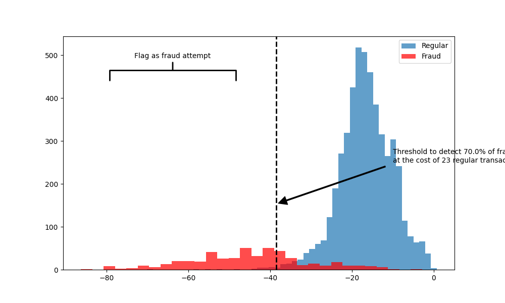

# Catching credit card fraud with a model that only knows "normal"

Fraud is rare. In the well known credit card dataset, only 492 of 284,807 transactions are fraud, which is 0.17%. A model that answers "not fraud" every time is 99.83% accurate and completely useless. This post explains how I built a fraud detector for that situation, deployed it, and then watched it fail in an interesting way.

## Step 0: audit the data

Before any modelling, I audited a pipeline that looked perfect. It had 3 leaks:
- **Target leakage:** a column that is only known after the event.
- **Temporal leakage:** a random split that mixed the past with the future.
- **Transformation leakage:** a scaler fitted on all the data before the split.

After fixing them, the honest score of a simple model was an F1 of 0.0000. That number is the real starting point. With such rare fraud, accuracy tells you nothing, so I used precision, recall and PR-AUC instead.

## The idea: learn what normal looks like

Instead of teaching a model what fraud looks like, I trained a variational autoencoder (VAE) on normal transactions only. A VAE squeezes each transaction into 2 numbers, then rebuilds it. A normal transaction is rebuilt well. A fraud looks unlike anything the model has seen, so the rebuild is poor.

Each transaction gets a score, the log of the expected reconstruction error (ERE), estimated with 30 Monte Carlo samples. A low score means a poor fit. If the score falls below a threshold, the transaction is flagged. I set the threshold at -58.64 so the model catches about 70% of the frauds on evaluation data.

Regular transactions are blue and frauds are red. The dashed line is the threshold.

## The pipeline

1. **Train and track:** every run is logged to MLflow, with parameters, metrics, plots and the saved model.
2. **Describe the deployment:** a KServe InferenceService YAML points to the model stored in MLflow.
3. **Deploy with GitOps:** the YAML is merged through a pull request, and ArgoCD syncs it to the Kubernetes cluster. Git is the single source of truth.
4. **Simulate live traffic:** a script sends transactions one by one to the live endpoint and scores the answers.

## Result on normal traffic

On the baseline traffic (5,492 transactions), the model caught 376 of 492 frauds, a recall of 0.76. It raised only 32 false alarms, which gives a precision of 0.92.

## Then the world changed

On the recent traffic, recall dropped to 0.25. The false alarms stayed at 32, so only the frauds had changed.

Was it a covariate shift, where the inputs change? I ran a two sample Kolmogorov-Smirnov test on the latent space of normal transactions. The p-values were 0.9992 and 0.9945, so normal behaviour had not moved. The average score of the frauds had moved from -61.75 to -45.25, towards the normal region. The share of missed frauds went from 23% to 76%.

That is a **concept shift**: the same kind of inputs now carry a different meaning, because fraudsters adapted and their transactions look normal.

I also ran an Evidently drift report. 15 columns (48%) were flagged as drifted. The distribution of the model scores barely moved (0.053, below the 0.1 limit), even though recall collapsed. Watching the predictions alone would not have raised the alarm. Quality metrics did, but they need labels.

## The canary release

To test a new model safely, I sent 20% of the traffic to a smaller challenger, with 14 features and 1 hidden layer, using `canaryTrafficPercent: 20` in the YAML.

On baseline traffic the canary had a recall of 0.713 against 0.761 for the stable model. That gap is within chance, because the canary saw only 94 frauds. It also raised fewer false alarms per missed fraud. On the recent traffic both models collapsed to a recall of about 0.24.

My decision was to keep the stable model. The canary was not better on either file, and swapping models does nothing about a concept shift. The only argument for the canary is that it is cheaper to run.

## What I take away

- Accuracy lies when classes are imbalanced.
- Check for leakage before anything else.
- A model that works today can quietly stop working, so monitor the features, the predictions and the quality.
- A canary limits the damage of a weaker model. With 20% of the traffic, the endpoint recall was 0.752 instead of the 0.761 of the stable model.
- The real fix for a concept shift is fresh labels, features that fraudsters cannot fake, and retraining.

## Code and data

All the code is in this repository, and the full numbers are in `output/async_results_and_answers.md`. The dataset is the Credit Card Fraud Detection dataset from Kaggle (ULB Machine Learning Group). It is too large for GitHub, so download it into `data/` to rerun the scripts. The course servers were shut down after the course, so the endpoint addresses in the scripts no longer work.
