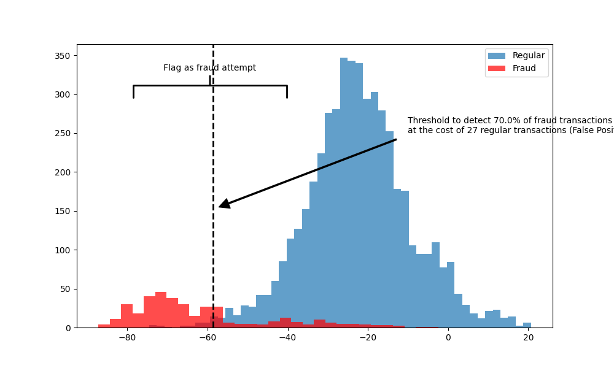
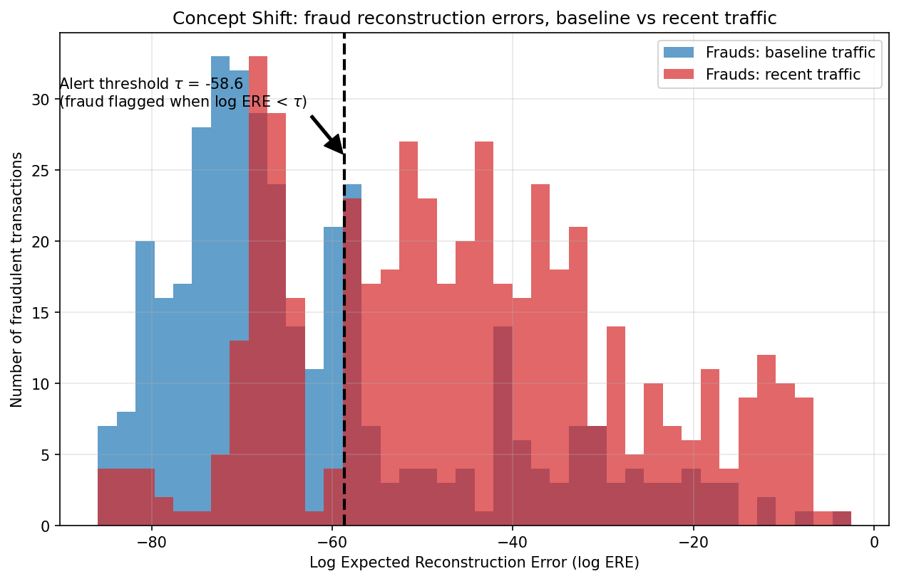
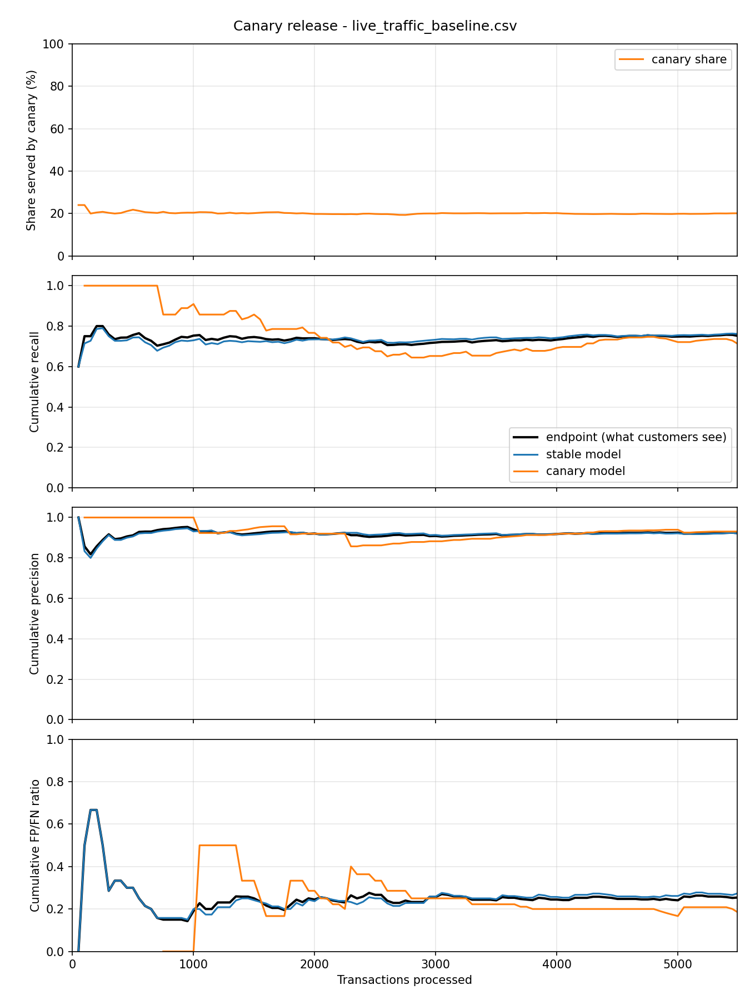
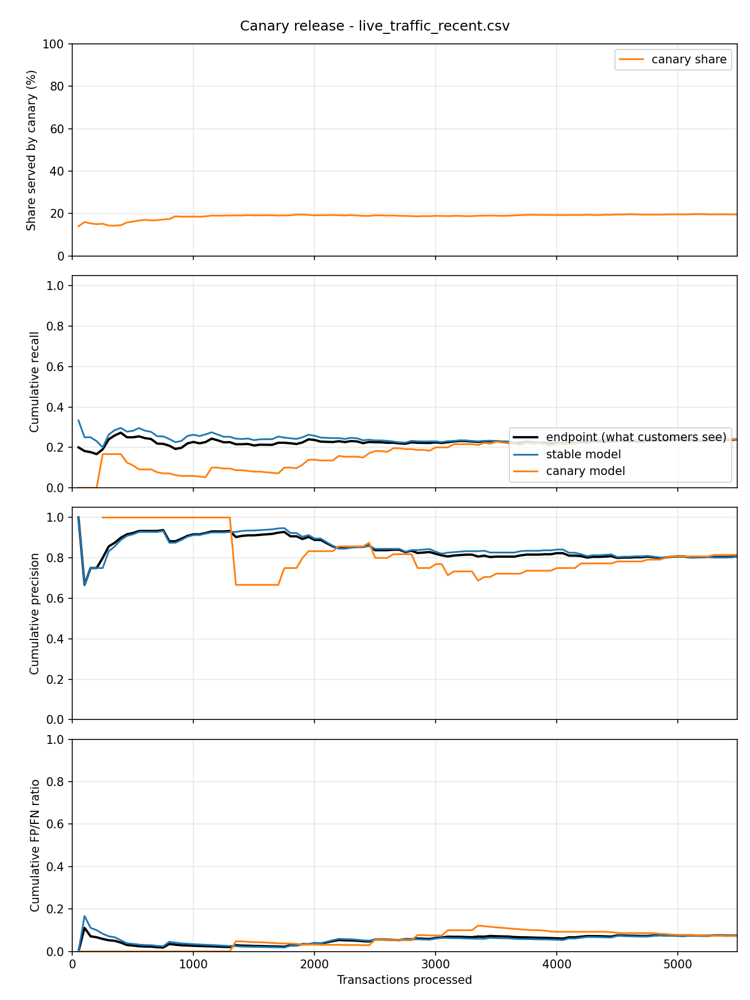

# Catching credit card fraud with a model that only knows "normal"

> **Note:** this version of the post was drafted by Claude, an AI assistant, from the results of my project. I will write my own version once I understand the material better.

This post tells the story of one project from start to finish. I built a program that spots credit card fraud, put it online, watched it work, and then watched it fail. You do not need any background in machine learning to follow it. Every technical word is explained when it first appears, and there is a small dictionary at the end.

## 1. The problem: a needle in a haystack

The data is a public list of 284,807 credit card payments. Only 492 of them are fraud, which is 0.17%. That is about 1 payment in 600.

This rarity creates a trap. Imagine a lazy program that answers "not fraud" for every single payment. It would be right 99.83% of the time, and it would catch exactly 0 thieves. A score that looks excellent can hide a program that is useless.

So I never judge the detector by how often it is right overall. I use 2 better questions:

- **Recall:** of all the real frauds, how many did we catch? If there are 100 frauds and we catch 76, recall is 0.76.
- **Precision:** of all the alarms we raised, how many were real? If we raise 100 alarms and 92 are real frauds, precision is 0.92.

A good detector needs both. High recall with low precision means the bank blocks the cards of honest customers all day. The opposite case means the alarms are trustworthy, but most thieves walk away.

## 2. First, check that the data is not cheating

Before building anything, I inspected a practice version of the data that the course had filled with hidden mistakes. A simple program trained on it looked almost perfect. It was cheating, in 3 ways. This kind of cheating is called **leakage**: information that the program should not have leaks into its training.

1. **An answer hidden in the questions.** One column said whether the account was blocked the next day. That is only known after the fraud is discovered. It is like an exam sheet with the solutions printed on the back.
2. **The future mixed with the past.** The payments were shuffled before being split into a part for learning and a part for testing. The program was learning from payments that happened after the ones it was tested on.
3. **A peek at the test.** The numbers were rescaled using averages computed over all the data, including the test part.

After I removed all 3, the same simple program caught no fraud at all. That sounds like bad news, but it is the honest starting point. A real 0 is more useful than a fake 100.

## 3. The idea: learn what normal looks like

There are too few frauds to teach a program what fraud looks like. So I turned the question around and taught it what **normal** looks like. Anything that does not fit is suspicious.

The tool for this is called a **variational autoencoder**, or VAE. Here is the idea without the mathematics:

- Each payment is described by 28 numbers.
- The VAE must squeeze those 28 numbers down to only 2.
- From those 2 values alone, it must then rebuild the original 28.

Think of an art student who has copied thousands of portraits of the same family. She can sketch any family member from a tiny note. Hand her a note about a stranger and her drawing comes out wrong, because she only knows that one family.

The VAE is that student. I trained it on normal payments only, so it becomes very good at rebuilding them. A fraud is a stranger, and the rebuild comes out poorly.

For each payment the model produces a **fit score**. (Its technical name is the log of the expected reconstruction error. The model rebuilds each payment 30 times and averages the result, because its rebuilding involves some randomness.) A score near -20 means "I rebuilt this well, it looks normal". A value near -70 means "I could not rebuild this, it looks strange".

Finally I need a rule to turn the score into a decision. I drew a line, called the **threshold**, at -58.64. Every payment that scores below the line is flagged as fraud. I placed the line so that about 70% of the known frauds fall under it.

*Each bar counts payments with a given fit score. Normal payments are blue and sit on the right. Frauds are red and sit mostly on the left. The dashed line is the threshold. The red bars to the right of the line are the frauds we miss.*

## 4. From my laptop to the internet

A model on a laptop helps nobody. A bank needs it online, answering in a fraction of a second, all day. Getting it there, and keeping it healthy, is called **MLOps** (machine learning operations). My pipeline had 4 parts.

1. **A lab notebook that writes itself.** A tool called MLflow recorded every training attempt: the settings, the scores, the pictures and the finished model. Nothing depends on my memory.
2. **A recipe card.** I wrote a short text file that says "run this exact model, give it this much computing power". The file is the full description of what should be online.
3. **A second pair of eyes.** I did not put the model online myself. I proposed my recipe card on GitHub, a website for sharing code, through a **pull request**. My teacher reviewed it and approved it.
4. **A robot that follows the recipe.** A program called ArgoCD watches GitHub. When a recipe card changes, it updates the servers to match. The servers are managed by Kubernetes, a system that keeps programs running on many computers, and a tool called KServe wraps the model so it can receive questions over the internet.

This way of working is called **GitOps**. Its main rule is that what is written on GitHub is the truth, and the servers always copy it. If something breaks, you go back to the previous version of the text file, and the robot undoes the change.

## 5. Day 1: it works

No real customers were involved. To imitate them, a script on my laptop sent 5,492 payments to the online model, one at a time: 5,000 normal ones and 492 frauds. The model answered each one.

| | Result |
|---|---|
| Frauds caught | 376 of 492 (recall 0.76) |
| Frauds missed | 116 |
| False alarms | 32 of 5,000 normal payments |
| Precision | 0.92 |

The detector caught 3 frauds out of 4 and almost never bothered an honest customer.

## 6. Then the world changed

The course provided a second batch of 5,492 payments, built to imitate what happens some months later. I sent it to the same model.

| | Day 1 batch | Later batch |
|---|---|---|
| Frauds caught | 376 of 492 | 121 of 492 |
| Recall | 0.76 | 0.25 |
| False alarms | 32 | 32 |

The model now caught only 1 fraud in 4. The false alarms did not change at all, which is a clue: the normal payments were being handled exactly as before. Something had happened to the frauds only.

I checked this in 2 steps.

**Did normal behaviour change?** I compared the normal payments of the 2 batches with a statistical test (the Kolmogorov-Smirnov test). It asks: could these 2 groups of numbers come from the same source? The answer comes as a value between 0 and 1, where a low value means "these are clearly different". I got 0.9992 and 0.9945. The honest customers had not changed.

**Did the frauds change?** Yes. Their average fit score moved from -61.75 to -45.25. They crossed the threshold line at -58.64 and landed on the "normal" side.

*The fit scores of the frauds in the first batch and in the later batch. In the later batch most frauds sit above the threshold, where the model treats them as normal.*

The fraudsters had learned to make their payments look ordinary. This has a name: **concept shift**. The data looks the same, but what it means has changed. A payment that looks normal used to be safe, and now it might not be.

It is the most dangerous kind of change, because it is quiet. I also ran a monitoring tool called Evidently, which compares 2 batches of data and reports what moved. The spread of the model's scores had barely changed (0.053, where the alarm level is 0.1). Only 9% of the payments in each batch are frauds, so their movement is drowned out by the 91% that stayed put. The collapse only became obvious once I compared the model's answers with the truth. In real life the truth arrives late, when customers complain.

## 7. A safer way to try a new model

Suppose I have a new model and I hope it is better. Replacing the old one at once is risky. A safer method is the **canary release**, named after the canaries that miners once carried underground to warn them of bad air. A small share of the traffic goes to the new model, while the trusted one keeps the rest. If the newcomer misbehaves, few customers are affected.

My new model was a smaller, cheaper VAE that reads only 14 of the 28 numbers. One extra line in the recipe card sent it 20% of the payments.

*First batch. The old model (80% of the traffic) and the new model (20%) are tracked as the payments arrive.*

| First batch | Old model | New model |
|---|---|---|
| Frauds seen | 398 | 94 |
| Recall | 0.76 | 0.71 |
| False alarms | 26 | 5 |

The new model looks slightly worse at catching fraud. But it only saw 94 frauds, and with so few cases a gap of this size can easily be luck, like 2 coins that give 7 and 8 heads in 10 flips. I cannot honestly say which one is better.

*Later batch, after the fraudsters adapted. Both models fall together.*

| Later batch | Old model | New model |
|---|---|---|
| Frauds seen | 401 | 91 |
| Recall | 0.24 | 0.24 |

On the later batch both models catch only 1 fraud in 4. This comparison is the important one. Both were trained on the same idea of "normal", so the same disguise fools them both.

**My decision: keep the old model.** The new one is not better on either batch. Its only advantage is that it is cheaper to run. Changing models was never going to fix the real problem.

## 8. What I learned

- **A high score can lie.** With rare events, "right 99.8% of the time" can mean "catches nothing".
- **Check for cheating first.** Leakage makes a bad model look brilliant.
- **A model is a photograph of the past.** The world keeps moving, and the opponents here move on purpose.
- **Watch more than one signal.** The inputs looked fine and the scores looked fine. Only the comparison with the truth showed the failure.
- **Try new things on a small share first.** A canary turns a possible disaster into a small, measured experiment.

The real fix for the adapted fraud is not a different model of the same kind. It is fresh examples of the new fraud, labelled by humans, new information that thieves cannot easily fake, and a new round of training.

## Small dictionary

| Word | Meaning |
|---|---|
| Model | A program that learned its rules from examples |
| Training | Showing examples to the model so it can learn |
| Recall | Share of real frauds that were caught |
| Precision | Share of alarms that were real frauds |
| Leakage | Information the model should not have during training |
| VAE | A model that squeezes data down and rebuilds it |
| Threshold | The line that turns a score into a yes or no |
| Deployment | Putting a model online so others can use it |
| MLflow | A tool that records every training attempt |
| Pull request | A proposed change that someone else reviews |
| GitOps | Servers that automatically copy what is written on GitHub |
| Kubernetes | A system that keeps programs running on many computers |
| Concept shift | The data looks the same but its meaning has changed |
| Canary release | Testing a new model on a small share of the traffic |

## Code and data

All the code is in this repository, and the full numbers are in `output/async_results_and_answers.md`. The data is the Credit Card Fraud Detection dataset from Kaggle (ULB Machine Learning Group). It is too large for GitHub, so download it into `data/` to rerun the scripts. The course servers were shut down after the course, so the internet addresses in the scripts no longer work.

This project was part of MST 0051 Machine Learning Operations at BI Norwegian Business School, Autumn 2026.
